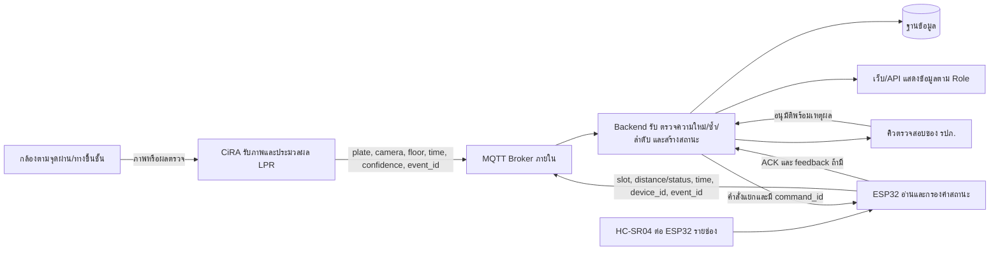
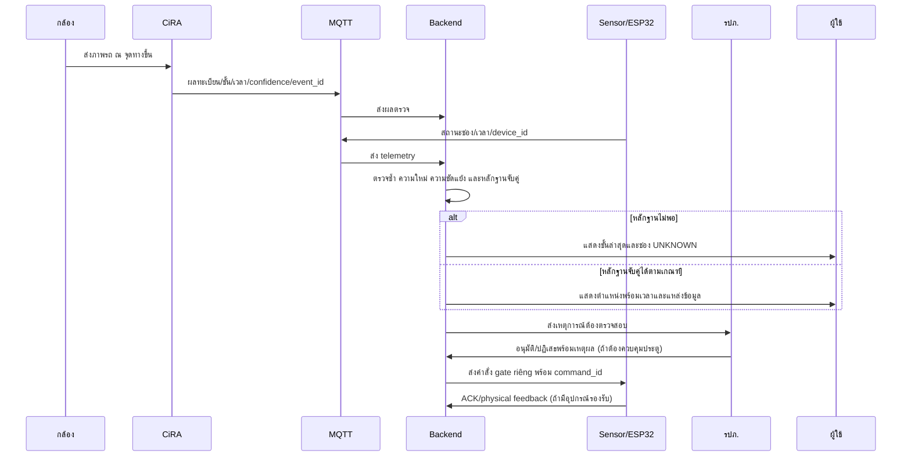

# การออกแบบระบบและแผนภาพ

## 1. ภาพรวมองค์ประกอบ

ภาพและผล LPR เป็นคนละชนิดข้อมูล: ภาพควรใช้ stream/snapshot transport ที่อุปกรณ์รองรับ ส่วนเหตุการณ์ LPR/telemetry ส่งเป็นข้อมูล MQTT หรือ API โดยมีรหัสกล้อง/อุปกรณ์และเวลาอ้างอิง ห้ามสมมติว่า MQTT payload มีภาพ เว้นแต่ระบบจริงกำหนดไว้เช่นนั้น

## 2. ลำดับเหตุการณ์ตัวอย่าง

## 3. การอนุมานชั้นและช่อง

1. กล้องแต่ละตัวต้องมี mapping คงที่ เช่น `camera_id -> floor_id, direction, zone`.
2. ผลตรวจกล้องบันทึกเป็น event แยก ไม่แก้สถานะ session โดยตรงเมื่อ confidence ต่ำหรือยังไม่ยืนยัน.
3. เซนเซอร์รายงานสถานะช่องพร้อม `slot_id`, `device_id`, เวลาอุปกรณ์ และ sequence/event ID.
4. การเชื่อม plate event กับ slot transition ใช้หน้าต่างเวลาและกฎที่ผ่านการทดสอบ; ถ้ามีหลาย candidate, event ซ้ำ, เวลาคลาดเคลื่อน หรือมีความขัดแย้ง ให้คง `UNKNOWN/CONFLICT`.
5. สถานะตำแหน่งผู้ใช้ควรบอกว่า “ตรวจพบล่าสุด” และระบุเวลา; ห้ามใช้ข้อมูลเก่าแสดงเป็นตำแหน่งสด.

เวลาที่รถผ่านกล้องชั้นหนึ่งและช่องเปลี่ยนจากว่างเป็นมีรถ ไม่ได้พิสูจน์เสมอว่ารถคันนั้นจอดช่องนั้น หากมีรถหลายคัน/ช่องหลายช่องในเวลาใกล้กัน ต้องไม่เลือกจับคู่โดยเดา

## 4. สถานะช่อง

| สถานะ | ความหมาย |
|---|---|
| `AVAILABLE` | มีหลักฐาน sensor สดและผ่านเกณฑ์ว่าว่าง |
| `OCCUPIED` | มีหลักฐาน sensor สดว่ามีรถ/วัตถุอยู่ |
| `RESERVED` | มีสิทธิ์/รายการจัดสรรหรือจองที่กำหนดโดยผู้มีสิทธิ์และยังมีผล |
| `UNKNOWN` | ไม่มีหลักฐานเพียงพอ, หมดอายุ, ยังไม่ตั้งค่า หรือยังระบุช่องไม่ได้ |
| `ERROR` | เซนเซอร์/อุปกรณ์รายงานข้อผิดพลาดหรืออ่านค่าไม่ถูกต้อง |
| `CONFLICT` | แหล่งหลักฐานที่สดให้ผลขัดกัน |

เฉพาะ `AVAILABLE` ที่ยืนยัน freshness ผ่านเกณฑ์จึงนับเป็นว่าง ห้ามนับ UNKNOWN/ERROR/CONFLICT เป็นว่าง

## 5. การทำงานเมื่อขัดข้อง

- **กล้อง/CiRA หยุด:** แจ้ง offline/stale; ไม่สร้างเหตุการณ์ใหม่จากการไม่มีภาพ.
- **Sensor/ESP32 หยุด:** สถานะช่องกลายเป็น UNKNOWN เมื่อเกิน freshness timeout.
- **MQTT หลุด:** ห้ามแสดงข้อมูลเก่าราวกับสด; พยายาม reconnect พร้อม backoff และใช้ event_id/deduplication เมื่อส่งซ้ำ.
- **Backend/DB หยุด:** อุปกรณ์จะ buffer ได้หรือไม่ต้องยืนยันจริง; เมื่อกลับมา server ต้องรับ event ตามลำดับ/เวลาและป้องกัน session ซ้ำ.
- **ไม่มี internet แต่ LAN ยังอยู่:** หาก broker/API อยู่ใน LAN ข้อมูลภายในอาจทำงานต่อได้; cloud weather/sheets/remote view อาจใช้งานไม่ได้.
- **ไฟดับ:** ต้องระบุ UPS/พฤติกรรมการกู้คืนเป็นขอบเขตอุปกรณ์จริง ห้ามอ้างว่าระบบทำงานต่อหากไม่มีพลังงานสำรอง.

## 6. การแยกสถานะไม้กั้น

`AI_DETECTION -> SECURITY_REVIEW -> COMMAND_SENT -> CONTROLLER_ACK -> PHYSICAL_GATE_FEEDBACK -> VEHICLE_PASSAGE -> SESSION_UPDATE`

แต่ละสถานะมีหลักฐานและเวลาแยกกัน การไม่มี event ถัดไปต้องแสดงว่าไม่ทราบ/ยังไม่ยืนยัน ห้ามกระโดดจาก `AI_DETECTION` ไป `VEHICLE_PASSAGE`

## 7. Diagram ที่ควรมีในรายงานนำเสนอ

1. Block diagram อุปกรณ์และเครือข่าย (หัวข้อ 1).
2. Sequence diagram ตั้งแต่รับภาพจนแสดงผล/อนุมัติ (หัวข้อ 2).
3. State diagram สำหรับ slot และ gate (หัวข้อ 4 และ 6).
4. Deployment diagram แสดง LAN, broker, backend, database, client และส่วน cloud (เติม host/port จริงหลังตรวจหน้างาน).

