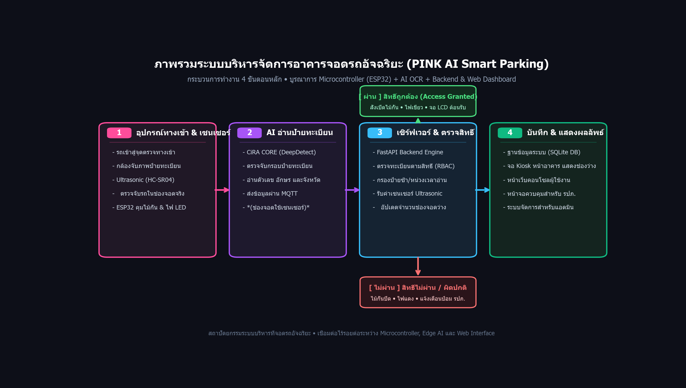
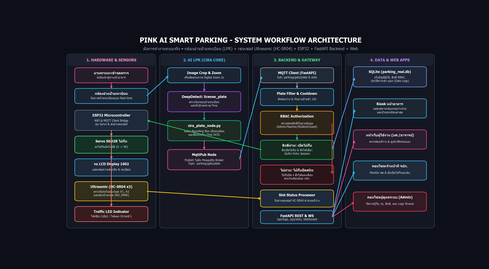

# 🚗 PINK AI Smart Parking System (ระบบบริหารจัดการอาคารจอดรถอัจฉริยะ)

ระบบบริหารจัดการอาคารจอดรถอัจฉริยะแบบ Low-Latency IoT เชื่อมต่อระหว่างอุปกรณ์ฮาร์ดแวร์หน้างาน (ESP32, Servo, Ultrasonic Sensor), ปัญญาประดิษฐ์ตรวจจับป้ายทะเบียนรถ (CiRA CORE DeepDetect), เซิร์ฟเวอร์กลาง (FastAPI / MQTT Engine) และเว็บแดชบอร์ดตรวจสอบสถานะแบบ Real-time ตามบทบาทผู้ใช้งาน (RBAC)

---

## 📌 สถาปัตยกรรมและการทำงานของระบบ (Architecture Workflow)

### 1. ภาพรวมระบบ 4 ขั้นตอนหลัก (Overview Workflow)


1. **อุปกรณ์หน้างาน & เซนเซอร์ (Entrance & Sensors):**
   - กล้องจับภาพป้ายทะเบียนยานพาหนะเมื่อขับเข้าจุดตรวจ
   - เซนเซอร์ Ultrasonic (HC-SR04 x3) ตรวจจับสถานะรถในช่องจอดจริง (#1, #2 และช่องห้ามจอด)
   - บอร์ดไมโครคอนโทรลเลอร์ ESP32 ควบคุมไม้กั้น (Servo SG92R) และไฟจราจร (Traffic LED)
2. **AI อ่านป้ายทะเบียน (CiRA CORE DeepDetect):**
   - ตรวจจับกรอบป้ายทะเบียน และถอดรหัสตัวเลข หมวดอักษร และจังหวัด
   - ส่งผลการอ่านผ่านโปรโตคอล MQTT (`parking/gate/plate`)
3. **เซิร์ฟเวอร์กลาง & ตรวจสอบสิทธิ์ (FastAPI Backend Engine):**
   - ตรวจสอบสิทธิ์ทะเบียนรถกับฐานข้อมูล (Whitelist & Role-Based Access Control)
   - กรองการอ่านป้ายซ้ำและป้องกัน Cooldown
   - หาก **ผ่าน**: สั่ง ESP32 ยกไม้กั้นขึ้น, แสดงไฟเขียว, แสดงข้อความต้อนรับบนจอ LCD
   - หาก **ไม่ผ่าน**: ไม้กั้นปิดสนิท, แสดงไฟแดง, ส่งสัญญาณแจ้งเตือนไปยังหน้าจอ รปภ.
4. **บันทึกข้อมูล & แสดงผลลัพธ์ (Storage & Dashboard):**
   - บันทึกประวัติการเข้า-ออกลงฐานข้อมูล SQLite (`parking_local.db`)
   - แสดงผลจำนวนช่องจอดว่างบนจอ Kiosk หน้าอาคาร
   - แสดงสถานะและประวัติบนเว็บคอนโซลตามสิทธิ์ของผู้ใช้งาน

### 2. ผังกระบวนการทำงานละเอียด (System Architecture Workflow)


---

## 🛠️ อุปกรณ์ฮาร์ดแวร์และการเชื่อมต่อ (Hardware Specifications)

- **บอร์ดประมวลผล:** ESP32 Dev Module
- **ไม้กั้นทางเข้า-ออก:** มอเตอร์เซอร์โว SG92R (PWM GPIO 15 / GPIO 13)
- **ไฟแสดงสถานะทางเข้า:** Traffic LED Module (ไฟเขียว GPIO 25, ไฟแดง GPIO 33)
- **เซนเซอร์ตรวจจับช่องจอด:** Ultrasonic HC-SR04 x3 (ตรวจช่องจอด #1, ช่องจอด #2 และช่องห้ามจอด NO_PARK)
- **จอแสดงผลหน้างาน:** LCD Display 1602 (I2C)

---

## 💻 โครงสร้างโฟลเดอร์โปรเจกต์ (Project Structure)

```text
parking/
├── backend/                  # โมดูล Backend API, Routers, Database Models
│   ├── database.py           # เชื่อมต่อ SQLite Database
│   ├── models.py             # โครงสร้างตาราง (Users, Logs, Slots)
│   └── routers/              # API endpoints (Auth, Logs, Users, System)
├── docs/                     # เอกสารประกอบและคู่มือระบบ
├── esp32_parking/            # ซอร์สโค้ดเฟิร์มแวร์ Arduino สำหรับบอร์ด ESP32
│   └── esp32_parking.ino
├── web/                      # ส่วนหน้าบ้านเว็บแอปพลิเคชัน (HTML, CSS, JS)
│   ├── login.html            # หน้าเข้าสู่ระบบ
│   ├── index.html            # แดชบอร์ดผู้ใช้งาน (นักศึกษา / อาจารย์)
│   ├── admin.html            # คอนโซลผู้ดูแลระบบ (Admin)
│   └── kiosk.html            # หน้าจอแสดงผล Kiosk หน้าอาคาร
├── service.py                # เซิร์ฟเวอร์หลัก FastAPI + Async MQTT Engine
├── config.py                 # โหลดการตั้งค่าจากไฟล์ .env
├── cira_plate_node.py        # โค้ดแปลงผลลัพธ์ป้ายทะเบียนจาก CiRA CORE
├── parking_local.db          # ฐานข้อมูล SQLite พร้อมข้อมูลผู้ใช้งานเริ่มต้น
├── requirements.txt          # รายการไลบรารี Python ที่ต้องติดตั้ง
├── mosquitto.conf            # ไฟล์คอนฟิก Mosquitto MQTT Broker
├── overview_workflow.drawio  # ไดอาแกรมภาพรวม (Draw.io)
├── workflow_diagram.drawio   # ไดอาแกรมระบบละเอียด (Draw.io)
└── README.md                 # เอกสารอธิบายโครงการ
```

---

## 🚀 วิธีการติดตั้งและรันระบบ (Getting Started)

### 1. ติดตั้ง Python Dependencies
```bash
pip install -r requirements.txt
```

### 2. ตั้งค่าไฟล์ Environment (.env)
คัดลอกไฟล์ `.env.example` เป็น `.env` และตั้งค่าตามต้องการ:
```bash
copy .env.example .env
```

### 3. เริ่มต้นรันเซิร์ฟเวอร์
```bash
python service.py
```
เซิร์ฟเวอร์จะเริ่มทำงานที่พอร์ต `8000`:
- **Web App / Login:** [http://localhost:8000/login](http://localhost:8000/login)
- **Admin Console:** [http://localhost:8000/admin](http://localhost:8000/admin)
- **Kiosk Display:** [http://localhost:8000/kiosk](http://localhost:8000/kiosk)
- **API Documentation:** [http://localhost:8000/docs](http://localhost:8000/docs)

---

## 👥 บัญชีผู้ใช้งานเริ่มต้นสำหรับการทดสอบ (Default Accounts)

| รหัสนักศึกษา/บุคลากร | ชื่อ - นามสกุล | บทบาท (Role) | สิทธิ์ในระบบ |
| :--- | :--- | :--- | :--- |
| `66056313` | คณิศร ชื่นสร้อย | แอดมิน (Admin) | สิทธิ์เต็ม จัดการระบบและผู้ใช้ |
| `66059445` | สกุลรัตน์ ตอนศรี | อาจารย์ (Teacher) | จอง/ตรวจสอบสิทธิ์ช่องจอดอาจารย์ |
| `66007192` | เจษฎา เช้าฉ้อง | นักศึกษา (Student) | ตรวจสอบที่ว่างและประวัติรถตนเอง |
| `66067189` | ภูริพัตร พรมแสง | รปภ. (Security) | สั่งเปิดไม้กั้นฉุกเฉินและตรวจสอบเหตุ |

*(รหัสผ่านเริ่มต้น: รหัสนักศึกษา/บุคลากร ของแต่ละท่าน)*
